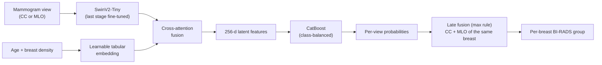

# Multimodal BI-RADS Assessment on VinDr-Mammo

Research internship project at **AIoT Lab Vietnam, International University – VNU-HCM** (Summer 2026), supervised by Dr. Le Duy Tan and Pham Duc Dat.

The project has two parts:
1. **A multimodal model** that predicts a breast's BI-RADS risk group from its two standard mammogram views (CC and MLO) together with the patient's age and breast density.
2. **[`mammo-validator`](mammo-validator)**, a web workbench where radiologists can view mammograms (including native DICOM), check the model's prediction, and approve or correct the label.

> ⚠️ This is a research prototype. It has not been clinically validated and must not be used for diagnosis.

---

## Task

[VinDr-Mammo](https://physionet.org/content/vindr-mammo/) gives a BI-RADS score (1–5) for each breast. The scores are grouped into three classes that match the clinical action a radiologist would take:

| Class | BI-RADS | Breasts in OOF set |
|---|---|---|
| Normal | 1 | 6,703 (67%) |
| Benign-leaning | 2–3 | 2,802 (28%) |
| Suspicious | 4–5 | 494 (5%) |

The Suspicious class is the one that matters most clinically, and it is also the rarest. Handling this imbalance is the main difficulty of the task ([`notebooks/01_eda_birads_imbalance.ipynb`](notebooks/01_eda_birads_imbalance.ipynb)).

## Method



1. **Image branch.** A pretrained SwinV2-Tiny (`swinv2_tiny_window16_256`), frozen except for its last stage, extracts features from each preprocessed mammogram (1024 × 1024).
2. **Tabular branch.** Age and breast density go through a learnable, FT-Transformer-style embedding.
3. **Cross-attention fusion.** The image features attend to the clinical features. The result is a 256-dimensional latent vector, trained with a class-weighted loss.
4. **Classifier.** CatBoost on the latent features, with class balancing. An evolutionary feature selector (IGWO-SOA) was also tried.
5. **Per-breast decision.** Each breast has a CC and an MLO view. The out-of-fold probabilities of the two views are combined with a max rule, so a lesion visible in only one view can still raise the breast's risk.
6. **Label-noise analysis.** [Confident Learning](https://github.com/cleanlab/cleanlab) is applied to the out-of-fold predictions to flag cases whose original label may be wrong. These flagged cases are what radiologists review in `mammo-validator` ([`notebooks/02_eda_label_noise.ipynb`](notebooks/02_eda_label_noise.ipynb)).

Evaluation uses **patient-grouped cross-validation**: all images of a patient are kept in the same fold, so the model is never tested on a patient it saw during training.

## Results

Out-of-fold results over 9,999 breasts, 4 folds, per-breast late fusion:

| Metric | Value |
|---|---|
| Macro-F1 | **0.454** |
| Accuracy | 0.647 |
| F1, Normal | 0.792 |
| F1, Benign-leaning | 0.343 |
| F1, Suspicious | 0.227 |

Combining the two views helps a lot. The same out-of-fold predictions scored per image, without late fusion, reach a macro-F1 of 0.322.

### Why the scores are modest

A macro-F1 of 0.454 is low in absolute terms. Several properties of the task and the dataset limit what any model can reach on it:

1. **The labels are radiologists' opinions, not biopsy results.** VinDr-Mammo has no BI-RADS 6 because biopsy results were not available. BI-RADS 2 findings were not annotated; only findings of BI-RADS 3 and above were marked with boxes ([Nguyen et al., *Scientific Data* 2023](https://arxiv.org/abs/2203.11205)). So the boundary between Normal and Benign-leaning has no localized evidence for a model to learn from.
2. **Radiologists themselves often disagree on BI-RADS.** Studies of screening mammography report only fair agreement between readers on the final BI-RADS assessment, for example κ = 0.37 in [a study of a Barcelona screening programme](https://pmc.ncbi.nlm.nih.gov/articles/PMC3500788/). A model trained on one reading per breast inherits that uncertainty.
3. **Severe class imbalance.** BI-RADS 4–5 make up about 5% of breasts, and BI-RADS 5 alone about 1%.
4. **Breast-level labels on view-level images.** Each breast has one label, which is copied to both of its views, even when a finding is visible in only one of them. Scoring per breast instead of per image raised macro-F1 from 0.322 to 0.454 with no retraining. This suggests that much of the per-image "error" comes from how labels are assigned, not from the model.
5. **Published results on the same dataset are in a similar range.** For example, a 2026 study reports a 5-class BI-RADS F1 of 50.4% on VinDr-Mammo, a large improvement over its baselines ([Token-based dual-view fusion, 2026](https://arxiv.org/abs/2607.06309)). Its class grouping and evaluation differ from this project's, so the numbers are not directly comparable.

The model has limits of its own as well. It uses a small backbone that is mostly frozen and trained for only 5 epochs, and full-resolution mammograms are downsampled to 1024 × 1024. Its main weakness is the Suspicious class, where F1 is only 0.227.

This is why the second half of the project is data-centric. Confident Learning flags **4,814 breasts (48.1%)** where the model confidently disagrees with the original label; about 65% of them sit between BI-RADS 1 and BI-RADS 2–3. These are **candidates for radiologist review** in `mammo-validator`, not confirmed labelling errors.

## Repository structure

```
notebooks/
  01_eda_birads_imbalance.ipynb      class distribution, original vs grouped BI-RADS
  02_eda_label_noise.ipynb           Confident Learning: suspected label errors
  03_per_image_baseline.ipynb        multimodal model, per-image evaluation
  04_per_breast_late_fusion.ipynb    full pipeline + per-breast multiview and late fusion
mammo-validator/                     radiologist review workbench (Next.js, SQLite, Python model inference)
```

See [`mammo-validator/README.md`](mammo-validator/README.md) for the workbench: features, setup and API.

## Data

VinDr-Mammo is distributed by PhysioNet under a credentialed-access license. **No images, DICOM files, patient metadata or derived predictions are included in this repository.** To reproduce the experiments, get access on PhysioNet and point the notebooks at your local copy. The notebooks were run on Kaggle.

## Credits

Developed by **Phan Xuan Khoa** ([@s4dz](https://github.com/s4dz)). Cao Tung Lam ([@Liamislazy](https://github.com/Liamislazy)) contributed to the first version of the `mammo-validator` interface.

Thanks to Dr. Le Duy Tan and Pham Duc Dat at AIoT Lab Vietnam for their supervision, and to the VinDr-Mammo authors for the dataset.
